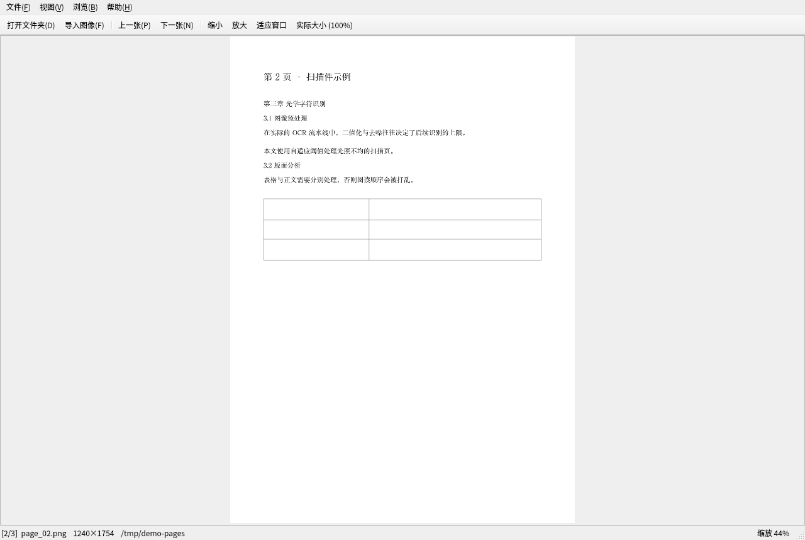

# ocr-proofread

OCR 校对 / 图像 ROI 标注工具（PySide6 + QGraphicsView）。

当前进度：**第一步 —— 打开图像、缩放、上下张切换**。ROI 绘制留待下一步。



## 环境准备

本项目使用 [uv](https://docs.astral.sh/uv/) 管理 Python 环境，解释器为 Python 3.14。

```bash
uv sync              # 创建 .venv 并安装依赖
uv run python -V     # 在虚拟环境中执行命令
```

> **依赖说明**：这里只装 `pyside6-essentials`（含 QtCore/QtGui/QtWidgets/QtSvg/QtTest 等），
> 而不是 `pyside6` 元包。后者会一并安装 Addons、WebEngine 等数百 MB 本工具用不到的模块。
> 以后若需要 `QtMultimedia`、`QtCharts` 等，再 `uv add pyside6-addons` 即可。

> **注意**：当前沙箱环境下 `$HOME` 中的 uv 缓存目录是只读的，因此本项目的 uv 缓存被放在项目内的 `.uv-cache/`（已加入 `.gitignore`）。
> 执行 `uv` 命令前请先设置：

```bash
export UV_CACHE_DIR="$PWD/.uv-cache"
```

## 运行

```bash
uv run ocr-proofread                       # 空窗口启动
uv run ocr-proofread ~/data/pages          # 直接打开文件夹
uv run ocr-proofread a.png b.jpg           # 直接打开若干图像
uv run python -m ocr_proofread <路径...>    # 等价写法
```

也可以用鼠标把文件夹或图像文件拖进窗口。

## 已实现功能

- **打开文件夹**：扫描文件夹内的图像（png/jpg/bmp/gif/webp/tif/…），按**自然顺序**排序
  （`img2.png` 排在 `img10.png` 前面），忽略隐藏文件与非图像文件。
- **导入图像**：多选文件，按选择顺序浏览。
- **浏览**：上一张 / 下一张、第一张 / 最后一张，到边界时对应动作自动禁用。
- **缩放**：以鼠标为锚点的滚轮缩放，快捷键放大/缩小，适应窗口、实际大小（100%）；
  缩放范围限制在 2%–4000%。窗口尺寸变化时，若仍处于"适应窗口"状态会自动重新适配。
  适应窗口沿用 Qt `fitInView` 语义：小图会被放大填满窗口，`Ctrl+1` 可回到 100%。
- **平移**：中键拖动（左键留给后续画 ROI）；Shift+滚轮水平滚动、Alt+滚轮垂直滚动。
- **状态栏**：`[当前/总数] 文件名 宽×高 所在目录` + 当前缩放百分比。
- 记住窗口大小与上次打开的目录；单张图读取失败时只在状态栏提示，不会中断浏览。

## 快捷键

| 按键 | 功能 |
| --- | --- |
| `Ctrl+Shift+O` | 打开文件夹 |
| `Ctrl+O` | 导入图像文件 |
| `←` / `A` / `PageUp` / `Backspace` | 上一张 |
| `→` / `D` / `PageDown` / `Space` | 下一张 |
| `Home` / `End` | 第一张 / 最后一张 |
| 滚轮 或 `Ctrl+滚轮` | 以鼠标为中心缩放 |
| `Ctrl+=` / `Ctrl+-` | 放大 / 缩小 |
| `Ctrl+0` 或 `F` | 适应窗口 |
| `Ctrl+1` | 实际大小（100%） |
| `Ctrl+Q` | 退出 |
| 中键拖动 | 平移画布 |
| `Shift+滚轮` / `Alt+滚轮` | 水平 / 垂直滚动 |

## 目录结构

```
.
├── pyproject.toml              # 项目与依赖定义
├── uv.lock                     # 锁定的依赖版本
├── .python-version             # 固定 Python 版本
├── docs/preview.png            # 界面预览图
├── src/ocr_proofread/
│   ├── __init__.py             # main() 入口
│   ├── __main__.py             # python -m ocr_proofread
│   ├── app.py                  # 主窗口：菜单、快捷键、打开/切换图像
│   ├── image_view.py           # QGraphicsView 子类：显示、缩放、平移
│   └── images.py               # 图像扫描、自然排序、读取（无界面依赖）
└── tests/smoke_test.py         # 无界面冒烟测试
```

## 开发

```bash
uv run ocr-proofread                  # 运行程序
uv run python tests/smoke_test.py     # 冒烟测试，37 项检查（无显示器时自动用 offscreen）
```

### 下一步（ROI 标注）预留的接口

- `ImageView.scene()`（`QGraphicsScene`）已就绪，ROI 图元直接 `addItem()` 到该场景；
  坐标原点即图像左上角，1 场景单位 = 1 图像像素。
- `ImageView.set_image()` 会清空场景，切图后需要由上层重新绘制该图的标注。
- 左键未绑定任何行为，可安全用于框选；中键平移与之互不冲突。
